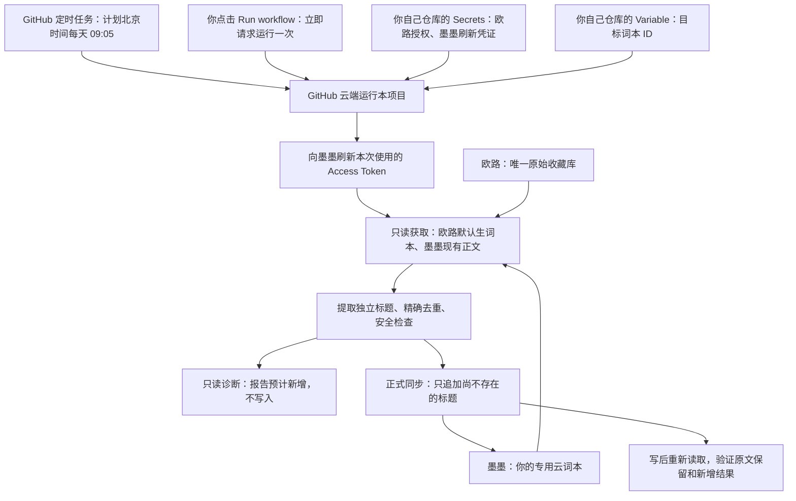

# EudicSyncToMaiMemo

**ShalliChan 维护版**

基于 [viazure/EudicSyncToMaiMemo](https://github.com/viazure/EudicSyncToMaiMemo) 开发，保留原有的欧路词典 → 墨墨背单词同步基础。本版本由 **ShalliChan 独立维护**，并非原作者的官方发布版本。

在欧路收藏单词或短语，之后由 GitHub 每天把有效标题添加到你的墨墨云词本。首次配置需要一台 Windows 电脑；配置完成后，电脑无需保持开机。

**第一次使用：[Windows 零基础部署教程](docs/windows-setup.md)**。本仓库文档覆盖安装软件、Fork、授权、配置、只读检查和首次同步，无需返回上游寻找配置步骤。不需要编程，也不需要编辑工作流。

## 它怎样运行

代码放在自己的 GitHub 仓库中，GitHub Actions 是替你在云端执行它的服务。手动按钮和定时计划运行的是同一套同步程序；手动运行一次不等于创建或开启定时计划。[定时运行说明](docs/windows-setup.md#9-确认每天自动运行)。

## 本版本扩展与功能边界

上游已提供同步、增量合并、去重及定时运行基础。本版本在此基础上扩展安全检查、授权管理和部署体验：

- **严格标题筛选**：只同步欧路独立收藏的有效英文单词或完整短语标题；不拆分短语、不生成词形或关联表达，不同步学习笔记、例句和 Markdown。无法可靠识别标题的记录会跳过并统计。
- **安全增量合并**：欧路新增 → 墨墨追加；欧路取消收藏 → 墨墨保留。完整标题精确去重，区分大小写；原有合法标题、章节、空行及换行完整保留，没有新增不写入。
- **OAuth 授权管理**：为定时同步接入 Access Token 自动刷新；授权异常即停止，不静默回退到固定 Token。
- **只读诊断与写后校验**：写入前可预检，写后重新读取并校验原文保留及新增结果；非法结构、重复标题或校验异常会触发保护。
- **Windows 部署与排障文档**：提供本仓库的零基础部署教程、验收步骤和分类排障说明，入口见下方帮助链接。

项目不修改欧路，不自动删除词汇、清空或重建词本。墨墨未收录的部分短语可能仍需在 App 中“自编此单词”并提交；项目不自动编写释义，也不保证墨墨对所有短语的解析展示完全一致。

## 开始前准备

- 自己的 GitHub、欧路词典和墨墨账号；欧路收藏已同步到欧路云端。
- Windows 10/11 电脑、浏览器，可正常连接 GitHub、npm 和两家的官方服务。
- 安装 **Git、GitHub CLI、Node.js 22**。教程有官方下载入口、安装选项和版本检查。
- 使用 Windows 自带的 **Windows PowerShell 5.1**。不要求另装 PowerShell 7、.NET SDK 或编辑器。

授权信息只放在自己仓库的 **Secrets**；词本 ID 放在 **Variables**。不要把凭证粘贴到 Issue、聊天、README 或截图中。[按教程配置](docs/windows-setup.md#6-配置欧路授权和墨墨目标)。

## 怎样算部署成功

1. **先只读检查**：`ready=1`，预计合并通过校验，没有非法行或重复标题。
2. **再手动同步**：`Sync Words` 成功，有新增时写后校验通过，手机上能看到目标词本。
3. **再次只读检查**：`missing=0`、`would_add=0`，原有内容保留。数量以自己的收藏为准，不需要达到其他人的词数。
4. **确认自动运行**：`Sync Words` 已启用，后续能看到由 `schedule` 触发的记录。

诊断成功不表示已经写入；没有新增的同步不表示测试过写权限。无需为验证去重而反复真实写入。[结果逐项解释](docs/windows-setup.md#7-首次只读预检)。

## 后续维护与帮助

- 每天计划 **UTC 01:05 / 北京时间 09:05**，GitHub 可能延迟，不能保证准点。Fork 的工作流需要自行启用；长期无仓库活动也可能被平台停用。
- 墨墨 OAuth 刷新凭证按当前官方 CLI 记录约 **90 天**到期，也可能提前撤销或失效。需要时重新登录并导入，不是永久免维护授权。
- `oauth_client_rejected` 与凭证过期是不同问题，先看[分类排障](docs/troubleshooting.md#oauth-client-rejected)，不要随意修改 OAuth 参数。

| 你要做的事 | 阅读位置 |
|---|---|
| 从零部署、找到下一步操作 | [Windows 教程](docs/windows-setup.md) |
| 命令找不到、登录失败、同步报错 | [故障排查](docs/troubleshooting.md) |
| 理解 OAuth、重新授权、固定 Token 手动回退 | [授权与高级配置](docs/maimemo-oauth.md) |
| 开发、测试、本地运行、Windows 服务 | [开发者说明](docs/development.md) |
| 查看本次真实用户反馈的核查结论 | [反馈对照与部署验收清单](docs/deployment-feedback.md) |

## 来源与许可

原项目作者为 **viazure**，原仓库：[viazure/EudicSyncToMaiMemo](https://github.com/viazure/EudicSyncToMaiMemo)。原作者保留其原始代码的版权，本仓库保留原有署名及 [MIT License](LICENSE) 版权声明。本 Fork 的新增和修改内容由 **ShalliChan** 维护。

通知功能参考 [jeessy2/ddns-go](https://github.com/jeessy2/ddns-go)。感谢真实部署反馈帮助改善教程。
